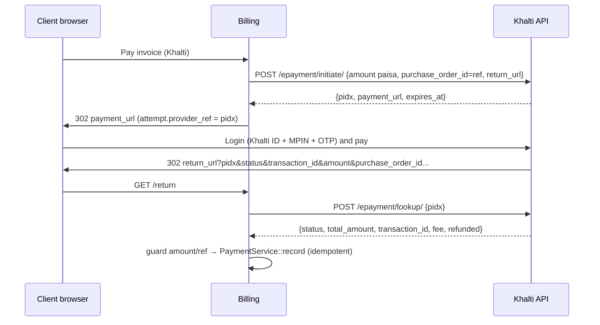
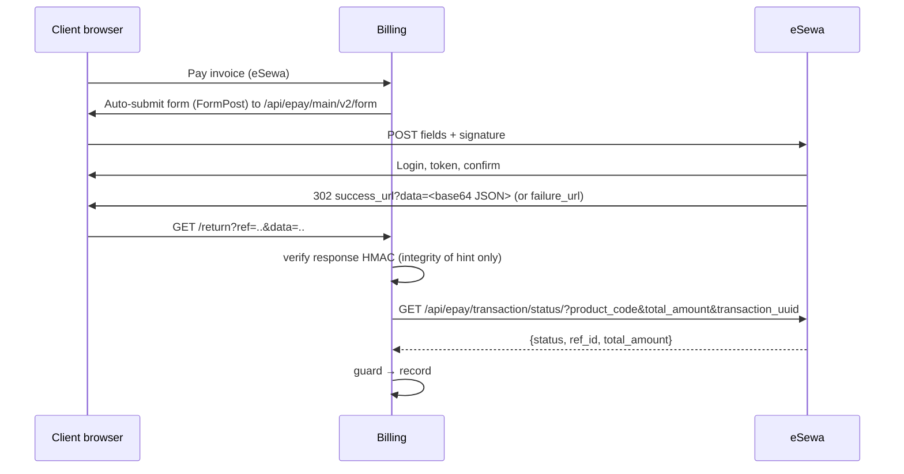
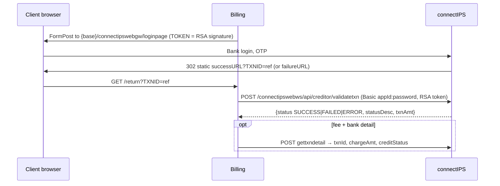

# Payments — Nepal gateway drivers (design, v1)

Status: Khalti and eSewa built (`app/Modules/PaymentsNepal`, see §8); ConnectIPS, Fonepay and IME Pay designed only · Owner: Billing (payments) · Refines `billing.md` §6 · Docs read 2026-10-17, re-verified 2026-10-18
Clean-room: written from the providers' public developer docs (see §7) in our own words. All keys, ids and
signatures below are **fake** unless marked "UAT (public)". Nothing here was copied from SDKs.

## 0. Key facts that shape the design

- **Nothing pushes to us.** None of the v1 providers publishes a server-to-server webhook for web checkout. The
  only inbound signal is the customer's browser coming back to a return URL. So each driver needs an
  authoritative **server-side lookup**, plus a **reconciliation poller** for customers who never come back.
  `billing.md` §7 lists the poller as COULD; for Nepal it is a **MUST**.
- **NPR only.** Every provider settles in NPR. A USD or INR invoice may only use these gateways through the
  gateway's `convert_to_currency = NPR` (§4.9), and the stored rate is used.
- **Amount units differ.** Khalti and ConnectIPS take integer **paisa** (that's our minor unit, so no conversion).
  eSewa, Fonepay and IME Pay take **rupee decimal strings**, and eSewa can send back `"1,130.0"`.
- **Refunds are mostly manual.** Only Khalti has a refund API. Everything else uses the merchant portal or the bank.
- **Merger:** Khalti's docs footer now reads "IME Khalti Limited", so IME Pay and Khalti have one owner. Khalti
  covers IME Pay's users for v1.

## 1. Provider comparison

|                   | Khalti (KPG-2)                              | eSewa (ePay v2)                       | ConnectIPS (NCHL)                                                   | Fonepay (web/QR)                                      | IME Pay                             |
| ----------------- | ------------------------------------------- | ------------------------------------- | ------------------------------------------------------------------- | ----------------------------------------------------- | ----------------------------------- |
| Model             | Server initiate → redirect to `payment_url` | Browser form POST → redirect back     | Browser form POST → redirect back                                   | GET redirect, or dynamic QR + poll                    | Server token → redirect             |
| Request auth      | `Authorization: Key <secret>`               | HMAC-SHA256, base64                   | RSA SHA256withRSA (merchant `.pfx`), base64                         | HMAC-SHA512, hex                                      | Basic auth + `Module` header        |
| Return signed?    | No (plain query)                            | Yes (base64 JSON with HMAC)           | No (only `TXNID`)                                                   | Yes (`DV`, HMAC-SHA512)                               | No (base64 pipe string)             |
| Verification API  | `POST /epayment/lookup/`                    | `GET /api/epay/transaction/status/`   | `POST /connectipswebws/api/creditor/validatetxn` (+ `gettxndetail`) | `GET /api/merchantRequest/verificationMerchant` (XML) | `POST /api/Web/Confirm`, `/Recheck` |
| Refund            | **API**, full or partial                    | Manual (portal); status shows refunds | Manual (via bank)                                                   | Manual                                                | Manual                              |
| Sandbox           | Self-serve (`dev.khalti.com`)               | Public UAT keys                       | On request (NCHL support)                                           | From the acquiring bank                               | On request                          |
| Amount unit       | paisa int (min 1000)                        | rupees string                         | paisa int                                                           | rupees string                                         | rupees                              |
| Expiry            | `expires_at` from API (60 min prod default) | Booking 50 min after the form post ¹  | Session based                                                       | Bank-defined                                          | Token based                         |
| Fees / settlement | Not public; Khalti wallet then bank         | Not public; withdraw to bank free     | Charge per txn (`chargeAmt`, `chargeLiability`)                     | Bank contract                                         | Not public                          |
| Public docs       | Yes                                         | Yes                                   | Yes                                                                 | **No** (bank-supplied spec)                           | **No**                              |
| v1 priority       | **P1**                                      | **P1**                                | **P2**                                                              | P3                                                    | P4 (Khalti covers it)               |

¹ eSewa UAT `bookingExpiryTime`, captured 2026-10-21 (§8.3). eSewa's docs say payment must follow login within 15
minutes; the captures show the booking itself stays open longer. How the login limit behaves was not tested.

Not in v1: **NPS OnePG** and **Hamro Pay** (aggregators; NPS also takes cards. Both have gated docs, so they're v2
candidates). **Bank card acquiring** (Nabil, NIC Asia and others run CyberSource/Mastercard-style hosted pages,
each under its own bank contract) is per-merchant, so we leave it for later. **PayPal** cannot pay out to Nepali
merchants and NRB limits foreign payment schemes, so don't offer it to NP entities.

## 2. Per-provider integration specs

Our side of every flow is the same. `initiate` creates a `payment_attempt` (§3.2) with a short unique
`reference` (format `inv-<invoice>-a<n>`; `[a-z0-9-]` only and at most 20 characters to fit ConnectIPS `TXNID`,
eSewa `transaction_uuid` and Fonepay `PRN` 3–25). The return URL is
`GET /billing/gateways/{key}/return?ref=<reference>`. It is **never authoritative**: it always ends in `lookup()`.

### 2.1 Khalti — KPG-2 Web Checkout (P1, built — deviations in §8.2)



- Base URL is `https://dev.khalti.com/api/v2/` in sandbox and `https://khalti.com/api/v2/` in production.
  Requests send the header `Authorization: Key <live_secret_key>`. The sandbox uses the "live" secret key from
  `test-admin.khalti.com`. A missing `Key ` prefix returns 401.
- **Initiate request:** `return_url`, `website_url`, `amount` (integer paisa, at least 1000), `purchase_order_id` (our
  ref), `purchase_order_name`, and optionally `customer_info{name,email,phone}`, `amount_breakdown[]` (must sum to
  amount), `product_details[]`, and `merchant_*` extras (echoed back). Validation errors come back as
  `{field: [msg], error_key: "validation_error"}`.
- **Return query:** `pidx, status (Completed|Pending|User canceled), transaction_id, tidx, txnId, amount,
  total_amount, mobile, purchase_order_id, purchase_order_name`. None of it is signed, so treat it all as hints.
- **Lookup response:** `{pidx, total_amount, status, transaction_id, fee, refunded}`. **Pitfall:** `Expired` and
  `User canceled` come back as **HTTP 400** with a normal body. Parse the body before treating it as a transport
  error.
- **Status mapping:** `Completed` → succeeded. `Pending` → pending; hold the service, raise a staff todo, keep
  polling. `Initiated` → pending until `expires_at`. `Expired` → expired. `User canceled` → cancelled (failed).
  `Refunded` / `Partially Refunded` → refunded; if the attempt was already paid, alert staff (§3.5). Khalti says
  only `Completed` counts as paid.
- **Refund:** `POST https://{dev.}khalti.com/api/merchant-transaction/{transaction_id}/refund/` with the same header.
  An empty body refunds in full; `{amount}` refunds part. Bank-funded payments also need `mobile` (store the payer
  `mobile` from the return in `raw`). The docs say "paisa" but the examples show `50.00`. Send integer paisa and
  confirm in sandbox. Success is `{"detail": "Transaction refund successful."}`.
- **Test data:** Khalti IDs 9800000000–9800000005, MPIN 1111, OTP 987654. The sandbox is wallet-only (no e-banking
  or cards). New live merchants are capped at NPR 200 per transaction until KYC. The sandbox sometimes returns "Fee
  not found", which is a merchant fee configuration problem, not ours.

### 2.2 eSewa — ePay v2 (P1, built — deviations in §8.3)



- **Form URL:** `https://rc-epay.esewa.com.np/api/epay/main/v2/form` (UAT) or `https://epay.esewa.com.np/...`
  (production). The status host is `rc.esewa.com.np` (UAT) or `esewa.com.np` (production).
- **Fields** (all required, use 0 when unused): `amount, tax_amount, product_service_charge,
  product_delivery_charge, total_amount` (= sum), `transaction_uuid` (`[A-Za-z0-9-]`, unique per request),
  `product_code`, `success_url`, `failure_url`, `signed_field_names`, `signature`, and up to 3 `properties[x]`.
  Send `amount = total_amount` and the other parts as `0`. Tax is already on our invoice, and splitting it invites
  sum mismatches.
- **Request signature:** HMAC-SHA256 with the merchant secret, base64-encoded, over `name=value` pairs joined with
  `,` in exactly the order given in `signed_field_names` (`total_amount,transaction_uuid,product_code`).
  The value strings must be byte-identical to the posted fields.
    - Example (fake key `fake-esewa-secret`): message `total_amount=1130.00,transaction_uuid=inv-1042-a1,product_code=EPAYTEST`
      → `LEnZDDJqIu1oogUAvNEgm4Wpg+/6f4vBwccI0ODlknU=`.
    - UAT key (public) `8gBm/:&EnhH.1/q`, product code `EPAYTEST`. **Pitfall:** the doc's own sample signatures
      do not reproduce with this key (we checked: the sample message gives `5DZywcrT…94E=`, not the published value).
      Use our own vectors.
- **Success return:** `data` = base64 JSON `{transaction_code, status, total_amount, transaction_uuid,
  product_code, signed_field_names, signature}`. Rebuild the message from _its_ `signed_field_names`. The list
  includes `signed_field_names` itself, and you use the raw strings as received. Example (fake key):
  `transaction_code=000ABCD,status=COMPLETE,total_amount=1,130.0,transaction_uuid=inv-1042-a1,product_code=EPAYTEST,signed_field_names=transaction_code,status,total_amount,transaction_uuid,product_code,signed_field_names`
  → `C9QSBh3Ovftd7ZkOZRW2g1+iCbF3NtqdeTqsEQ/RNwo=`. **Pitfall:** `total_amount` is formatted with thousands
  separators. Sign the raw value, and strip `,` only when converting it to paisa.
- **Status check** (authoritative, unsigned, TLS): pass _our_ expected `total_amount`. Read
  `{product_code, transaction_uuid, total_amount, status, ref_id}`, where `ref_id` is the provider txn id.
- **Status mapping:** `COMPLETE` → succeeded. `PENDING` → pending. `AMBIGUOUS` → pending, and alert staff after
  the grace period (never auto-fail). `NOT_FOUND` → no payable session (see §8.3: this is also what a cancel
  answers): a pending attempt ends on the customer's cancel return, or once it is 5 minutes old; never paid.
  `CANCELED` → failed. `FULL_REFUND` / `PARTIAL_REFUND` → refunded (§3.5). The body `{code:0, error_message}` means a transient
  outage, so back off and retry.
- `failure_url` is also used for PENDING, so failure is still a hint: look it up anyway. eSewa recommends a
  status check if there's no answer within 5 minutes.
- **Test data:** eSewa ID 9806800001–9806800005 (older page: 9711111111/2/3), password `Nepal@123`, MPIN 1122, OTP
  token 123456.

### 2.3 ConnectIPS — NCHL connectIPS Gateway (P2)



- The base URL is assigned by NCHL (community integrations use `uat.connectips.com` and `login.connectips.com`;
  confirm at onboarding). Merchants enrol through their bank and receive `MERCHANTID` (int), `APPID`, `APPNAME`,
  a password, and a signing certificate (`CREDITOR.pfx` in test).
- **Form fields** (max lengths): `MERCHANTID(20) APPID(15) APPNAME(30) TXNID(20, unique per app)
  TXNDATE(DD-MM-YYYY, Asia/Kathmandu) TXNCRNCY(NPR) TXNAMT(paisa int) REFERENCEID(20) REMARKS(50) PARTICULARS(100)
  TOKEN(512)`.
- **Token:** SHA256withRSA over
  `MERCHANTID=…,APPID=…,APPNAME=…,TXNID=…,TXNDATE=…,TXNCRNCY=…,TXNAMT=…,REFERENCEID=…,REMARKS=…,PARTICULARS=…,TOKEN=TOKEN`,
  base64-encoded. That is 11 pairs, the literal `TOKEN=TOKEN` comes last, and there is **no whitespace**.
  **Pitfall:** the spec's template shows `", "` after the first few commas, but its worked example has none. Follow
  the example. Validation token: `MERCHANTID=…,APPID=…,REFERENCEID=<TXNID>,TXNAMT=<paisa>`.
    ```php
    // our sketch — key is a PEM exported once from the .pfx and stored as a secret setting
    openssl_sign($message, $sig, openssl_pkey_get_private($pem), OPENSSL_ALGO_SHA256);
    $token = base64_encode($sig);
    ```
- **Redirect:** success and failure URLs are **static** and registered with NCHL. NCHL appends only `TXNID`, so the
  same `TXNID` can arrive more than once and the route must be idempotent.
- **Status mapping:** `SUCCESS` → succeeded. `FAILED` → failed. `ERROR` + "NOT FOUND"/"INCOMPLETE" → pending
  until the TTL, then expired. `gettxndetail.creditStatus` ∈ {`000`, `999`, `DEFER`} counts as success, and
  `chargeAmt` (paisa) is recorded as the fee only when `chargeLiability = MN`.
  **Pitfall:** `txnAmt` comes back as `"500"` from validatetxn and `1000.00` from gettxndetail, so normalise
  both before comparing.
- A duplicate `TXNID` gives a 403 ("multiple gateway payments"). Each retry must be a new attempt with a new
  reference.

### 2.4 Fonepay (P3 — bank-supplied spec, verify before build)

No public official docs exist. The shape below comes from public community integrations and must be checked
against the spec the acquiring bank supplies before any build.

- **Web:** `GET https://{dev-}clientapi.fonepay.com/api/merchantRequest` with `PID` (merchant code), `MD=P`,
  `PRN` (3–25), `AMT` (rupees), `CRN=NPR`, `DT` (MM/DD/YYYY), `R1`, `R2`, `RU`, and `DV`.
  `DV` = hex HMAC-SHA512 over the values (not names) joined with `,` in the order PID,MD,PRN,AMT,CRN,DT,R1,R2,RU.
  Fake-key example (`fake-fonepay-secret`):
  `NBQM,P,inv-1042-a1,1130.00,NPR,10/17/2026,Invoice 1042,N/A,https://billing.example.np/billing/gateways/fonepay/return`
  → `d31a4efa8492…5df571` (full vector goes in tests).
- **Return:** `PRN, PID, PS, RC, UID, BC, INI, P_AMT, R_AMT, DV` (DV over PRN,PID,PS,RC,UID,BC,INI,P_AMT,R_AMT).
  Compare it without regard to case. Then verify with `verificationMerchant?PRN&PID&BID&AMT&UID&DV`, where DV is
  over PID,AMT,PRN,BID,UID. The reply is XML; succeeded only on `success=true` plus a "successful" response code.
- **Dynamic QR** (in-page, COULD): `POST merchantapi.fonepay.com/api/merchant/merchantDetailsForThirdParty/thirdPartyDynamicQrDownload`
  `{amount, remarks1, remarks2, prn, merchantCode, dataValidation, username, password}`. The HMAC-SHA512 is over
  `amount,prn,merchantCode,remarks1,remarks2`. The reply gives `qrMessage` plus websocket URLs. Poll
  `…/thirdPartyDynamicQrGetStatus` with an HMAC over `prn,merchantCode`. Never store merchant credentials per QR
  row, as one community package does. This is the `QrPayload` instruction type.

### 2.5 IME Pay (P4 — on request)

The shape comes from community integrations; confirm it with IME Khalti. `POST /api/Web/GetToken` takes
`{MerchantCode, Amount, RefId}` with Basic auth and a `Module: base64(module)` header and returns `TokenId`.
The browser is then sent to `/WebCheckout/Checkout` with base64 of
`TokenId|MerchantCode|RefId|Amount|GET|RespUrl|CancelUrl`. The return is a base64 pipe string
`ResponseCode|ResponseDescription|Msisdn|TransactionId|RefId|TranAmount|TokenId`. It is **unsigned**, so
`POST /api/Web/Confirm` (or `/Recheck` if it never returned) is mandatory, and `TokenId` and `RefId` must
match what we sent. Hosts seen: `stg.imepay.com.np:7979` (staging) and `payment.imepay.com.np:7979`
(production). The non-standard port matters for egress firewalls.

## 3. Driver design (fits `Drivers/Gateways/GatewayDriver`)

The current interface (Billing worktree) covers `capture`, `refund`, `parseCallback` (signed POST webhook) and
`settingsFields` (`string|text|secret`). It has the `REDIRECT` capability constant but **no method to start a
redirect**, **no lookup**, **no return-URL handling**, and no way to express "expired". Proposed additions follow.

### 3.1 Interface additions

```php
interface HostedPaymentDriver extends GatewayDriver            // opt-in; manual/card drivers unaffected
{
    public const LOOKUP = 'lookup'; public const QR = 'qr'; public const PARTIAL_REFUND = 'partial_refund';

    /** @return list<string> ISO codes the provider settles in, e.g. ['NPR'] */
    public function currencies(): array;
    public function limits(Gateway $gateway): AmountLimits;             // min/max minor units (Khalti min 1000)
    public function attemptTtl(Gateway $gateway): CarbonInterval;       // e.g. Khalti 60m, eSewa 60m

    /** Server-side preparation; may call the provider (Khalti/IME initiate). */
    public function initiate(Gateway $gateway, PaymentIntent $intent): RedirectInstruction|FormPost|QrPayload;

    /** Parse the browser return. Verifies any signature, returns hints only — never marks paid. */
    public function parseReturn(Gateway $gateway, Request $request): ReturnHint;   // reference, providerRef?, claimedStatus

    /** Authoritative status from the provider. Must be safe to call repeatedly. */
    public function lookup(Gateway $gateway, PaymentAttemptRef $attempt): LookupResult;
}
```

- `PaymentIntent` (readonly) holds `reference`, `Money $amount`, `description`, `returnUrl`, `cancelUrl`,
  `customerName/email/phone`, and `invoiceId|batchId`. Drivers never load models.
- `RedirectInstruction{url}`, `FormPost{action, fields}` (rendered as a CSP-safe auto-submit page) and
  `QrPayload{payload, expiresAt}` are the three instruction types.
- `LookupResult{status: succeeded|pending|failed|expired|cancelled|refunded|partially_refunded, providerTxnId,
  amount (minor), currency, fee, payerRef, raw (redacted), retryable}`.
- `settingsFields()` gains the types `boolean` (sandbox toggle), `select{options}`, `secret_text` (multi-line PEM),
  plus `required` and `default`. Secrets keep going into `gateways.config` (`encrypted:array`), and the admin UI
  never echoes them back (it shows "••• set", and an empty submit keeps the old value).
- Module-level tunables go in the `SettingsRegistry` billing section:
  `billing.gateways.lookup_interval_minutes` (5), `billing.gateways.lookups_per_run` (200, at most 1,000; least
  recently checked first, 4-minute deadline per run), `billing.gateways.lookup_grace_minutes` (120),
  `billing.gateways.http_timeout_seconds` (15), `billing.gateways.ambiguous_alert_minutes` (30),
  `billing.gateways.late_lookup_hours` (48), `billing.gateways.late_lookups_per_run` (100),
  `billing.gateways.refund_check_days` (7) and `billing.gateways.refund_checks_per_run` (300) (§3.5).
- **Packaging (an "extension"):** each extension is one class `Drivers/Gateways/Nepal/<Name>Driver.php` plus
  endpoint config in `Config/billing.php` → `gateways.<key>.{sandbox,live}` plus one line in
  `BillingServiceProvider` (`$manager->register(...)`) plus Http::fake fixtures and a contract-test dataset entry.
  No per-driver migration is needed. A new gateway is roughly 150–250 LOC.
  For drivers living **outside** Billing (a separate module), the interface and DTOs must move to `app/Contracts/Billing`
  and `app/Data/Billing`, because the architecture rules forbid importing Billing classes. That needs a CTO decision.

### 3.2 New table + flow (Billing migration)

`payment_attempts: id, reference (unique, ≤20), gateway, invoice_id|payment_batch_id, client_id, amount, currency,
fx_rate (nullable), provider_ref (pidx/token), provider_txn_id, status (initiated|pending|succeeded|failed|expired|cancelled),
expires_at, last_lookup_at, lookup_count, raw (redacted json), timestamps`, with a unique index on
`(gateway, provider_txn_id)`.

1. **Initiate:** check the invoice is payable by this client. Check the currency is NPR (or convert at the
   gateway's rate). Check the amount is within `limits()` and equals the current balance. Create the attempt, call
   `initiate`, and return the instruction. Reusing an unexpired attempt for the same amount is allowed; otherwise
   create a new reference.
2. **Return** (`GET|POST billing/gateways/{key}/return`, no auth needed, CSRF-exempt only for the POST, throttled):
   `parseReturn` → load the attempt by reference **and gateway** → `lookup` → `settle()` → redirect to the invoice
   page with a flash message. A missing or invalid signature still triggers a lookup, but the attempt is never
   marked paid from the hint.
3. **Settle** (shared by the return route and the poller): lock the attempt with `lockForUpdate`, then run the
   guards in order:
    - `status=succeeded`
    - `currency == attempt.currency`
    - `amount == attempt.amount` (on a mismatch: no record; log it, raise a staff todo and alert)
    - reference matches
    - `provider_txn_id` is not already used by another attempt

    Then call `PaymentService::record` with `(gateway, provider_txn_id, payment)`. A unique-index hit means already
    recorded, so return OK. `InvoicePaid` fires only on the status transition.

4. **Poller** (`Automation::SYNC` plus an every-5-minute scheduled job): attempts in initiated/pending with
   `last_lookup_at` older than the interval and `now < expires_at + grace`. It uses exponential backoff. Past the
   grace period it marks the attempt expired, unless the last status was AMBIGUOUS/Pending, which stays and gets a
   staff todo.
   Closed attempts (expired, failed) are looked up again once an hour, on a schedule entry of their own, for
   `billing.gateways.late_lookup_hours` (48, 0 = off, at most 168) after they started; a success found then is
   booked as a late payment (billing.md §13). The customer's return looks a closed attempt up only inside that
   window.

### 3.3 Status mapping summary

| Ours               | Khalti                       | eSewa                                | ConnectIPS                 | Fonepay                  | IME Pay         |
| ------------------ | ---------------------------- | ------------------------------------ | -------------------------- | ------------------------ | --------------- |
| succeeded          | Completed                    | COMPLETE                             | SUCCESS (+creditStatus ok) | PS=true + verify success | Confirm code 0  |
| pending            | Pending, Initiated           | PENDING, AMBIGUOUS, NOT_FOUND (<TTL) | ERROR (<TTL)               | not verified (<TTL)      | Recheck pending |
| failed / cancelled | User canceled                | CANCELED                             | FAILED                     | explicit failure         | non-0 final     |
| expired            | Expired                      | NOT_FOUND (≥TTL)                     | ERROR (≥TTL)               | ≥TTL                     | ≥TTL            |
| refunded           | Refunded, Partially Refunded | FULL_REFUND, PARTIAL_REFUND          | (manual)                   | (manual)                 | (manual)        |

### 3.4 Refunds

Khalti declares `refund` (and `partial_refund` only once its unit is proven, see §8.2) and uses the existing `refund(Gateway, Transaction, Money)`.
Every other driver omits `refund`. After refunding in the provider portal, staff record it with `record_only` (§4.7),
and the UI shows "Refund in the eSewa/ConnectIPS portal first." `to_credit` is never the way to record a portal
refund: it gives the client the same amount again as account credit. The part of a payment that went to account
credit is recorded with Refund account credit (recorded) instead.

### 3.5 Refunds seen by lookup

A lookup on an already-paid attempt that reports Refunded / FULL_REFUND does **not** move money automatically. It
creates a staff todo with a "record refund" action, so a refund made in the provider portal does not leave the
customer with credit they never had.

**Built (#27): the daily re-lookup of paid attempts** (`Billing\Services\SettledRefundCheck`, automation task
`billing.gateway_refund_check`, stage SYNC). Attempts refunded _before_ we saw them go to staff review, as before.

- **Which attempts:** succeeded, booked (`transaction_id` set), started within `billing.gateways.refund_check_days` (7, 0 =
  off, at most 30), on a gateway whose driver supports `lookup` but not `webhook` (Khalti and eSewa; Stripe and the
  sandbox card push refunds by webhook). Each is looked up at most once every 20 hours, so a forced re-run of the day's
  task calls no provider again. The query reads `payment_attempts_created_at_index` (a week of attempts, not the table),
  least recently looked up first, at most `billing.gateways.refund_checks_per_run` (300, at most 1,000), with a 10-minute
  deadline. A transient error (`retryable`) stops that gateway for the run and leaves the attempt unstamped.
- **What is flagged:** a `refunded` answer while the payment's own refund rows (succeeded or pending, including payouts
  of account credit through the gateway, but never refunds to account credit, which pay nothing out) total less than the payment,
  counting also a payout of the payment's credit (its overpayment, or its own refunds to credit) recorded with Refund
  account credit (recorded). That payout names no payment, so it counts only up to what the client no longer holds:
  payouts recorded since the payment, and at most the payment's credit less the client's credit balance now. A client
  who still holds the credit is flagged, or a `partially_refunded` answer while it has none. The answer is applied under
  the payment's lock, then the attempt's, the order the provider refund callback uses; a staff refund reserves under the
  payment's lock, so it is either counted or comes after the flag (race tests on PostgreSQL). Neither provider reports the
  refunded amount, so a second partial portal refund after one recorded here is not told apart.
- **What happens:** no money moves. The attempt gets `check_reason = portal_refund` (to-do "Refunds made at the provider to
  record", `billing.payments.manage`), a review reason, `raw.portal_refund` (status, time, amount refunded here, amount
  the payment left as credit) and an activity entry `billing.payment.portal_refund`. Staff record the refund on the
  invoice (Refund → record); for the part the payment left as account credit, or that a refund to credit turned into
  credit, which the invoice's refund refuses, the reason points to Refund account credit. Then they mark the payment checked. An open late or credit flag on the same
  attempt is not lost: it is kept in `raw.portal_refund.previous_check` and after "; was:" in the review reason. The same status is not flagged twice; a partial refund that becomes full is flagged again.
- **Khalti bank-funded payments** stay manual for v1 (no payer mobile number stored): every refund Khalti declines tells
  staff to refund a bank-funded payment in the Khalti portal and record it.

## 4. Security checklist

- [x] Secrets (Khalti key, eSewa secret, ConnectIPS password + PEM, Fonepay secret) stay only in `gateways.config`
      (encrypted). They are never in `.env` per tenant, logs, `raw`, exceptions or Inertia props.
- [x] Logs and `raw` go through a redactor: drop `Authorization`, `TOKEN`, `signature`, `DV`, `dataValidation`,
      `password`, and mask `mobile`/`Msisdn` (keep the last 3 digits). `gateway_log` stores the redacted payload plus
      the result.
- [x] Mark paid **only** from `lookup()`, never from return params, even ones with a valid HMAC.
- [x] Guard amount (minor units, after normalising `"1,130.0"`/`"500"`/`1000.00`), currency (NPR) and our reference
      against the **stored attempt**, not against the request or the current invoice balance.
- [x] Replay: the unique `(gateway, provider_txn_id)` index plus a locked attempt state machine means a replayed
      success URL is a no-op. Return routes are bound by `reference` + gateway, so a token for invoice A can't settle B.
- [x] Compare signatures with `hash_equals`. Rebuild them from the provider's `signed_field_names`, never from a
      fixed list, and reject any unknown signed field.
- [x] CSRF exemption applies only to the provider return POST route (and the existing webhook route). It is never
      applied to `initiate`.
- [x] IP allow-list: no provider publishes callback ranges, and there are no server callbacks in v1, so this is
      N/A. Restrict **egress** instead (Khalti, eSewa and NCHL hosts; IME port 7979).
- [x] Outbound HTTP: connect timeout 5s, total 15s, `retry(2)` on background lookups only (never on initiate, refund
      or the customer's return, which makes one try with a 6 s timeout), TLS verification on, and a pinned host per
      environment from config (never taken from user input). Pinning chooses which hosts we call; it is not an egress
      firewall.
- [x] Sandbox and live keys are separate. The sandbox toggle switches endpoints, and the admin shows a "SANDBOX"
      badge on the gateway and on the invoice payment rows.
- [x] The open redirect is closed: `return_url`/`success_url` are built server-side from route names, and the
      reference is validated against `[a-z0-9-]{3,40}` (the attempt reference is 26 characters, see §8.4).
- [x] Rate limits are not published by any provider. Apply our own: throttle the return route (60/min/IP), allow at
      most 1 lookup per attempt per minute, back off on 5xx or `code:0`, and limit client pay requests (single and
      batch) to 10 per minute per user, since each can open a provider session with the merchant key.

## 5. Testing strategy

- **Http::fake fixtures** per provider (`tests/Fixtures/Gateways/<key>/*.json`): initiate ok and validation error.
  Lookup for every status, including Khalti's HTTP 400 statuses. eSewa `code:0` outage. ConnectIPS validatetxn and
  gettxndetail. Fonepay XML. A malformed body. A timeout (`Http::fake` throwing `ConnectionException`).
- **Signature unit tests** with our own fixed vectors (§2.2, §2.4). Docs vectors are not used, because eSewa's
  published samples don't reproduce. ConnectIPS: a throwaway RSA key pair in fixtures; sign, then
  `openssl_verify` with the public key; also assert the exact canonical string, with no spaces.
- **Shared contract test** (Pest dataset over all `HostedPaymentDriver`s):
    - `currencies()` is non-empty
    - `initiate` rejects a non-NPR intent
    - `parseReturn` with a tampered amount or signature never yields succeeded
    - `lookup` is idempotent
    - the mapped status is in the enum
    - `raw` contains no configured secret (grep every secret value)
    - settings fields of type `secret` are never serialised to the frontend
- **Feature tests** (acceptance):
    - double return or replay → one transaction, `InvoicePaid` fires once
    - amount mismatch → no payment, a staff todo is raised and the event is logged
    - return without lookup success → invoice stays unpaid
    - poller settles an attempt whose customer never returned
    - expiry after grace
    - IDOR: client B can't start or settle client A's attempt
    - Khalti partial refund
    - an out-of-band refund raises a todo

## 6. Recommendation and order

1. **Interface + `payment_attempts` + return route + poller + redactor** (shared, the bulk of the risk).
2. **Khalti** (cleanest API, self-serve sandbox, refund API, also reaches IME Pay users).
3. **eSewa** (largest wallet; public UAT; form-post + HMAC).
4. **ConnectIPS** (bank accounts directly; needs NCHL onboarding plus certificate handling, so start the paperwork now).
5. Fonepay (bank-supplied spec; QR is attractive for in-person), then NPS OnePG or Hamro Pay if customers ask.
   IME Pay only on demand.

**India (later):** **Razorpay** (Orders API → Checkout; HMAC-SHA256 over `order_id|payment_id`; signed webhooks;
refund API; amounts in paise; also e-mandates/UPI Autopay for renewals). **Cashfree** (Orders + session, webhook
signature over timestamp+body, refunds API). **PayU** (hash-based form post with a SHA-512 hash, verify_payment API).
All of them are INR, have real webhooks (they fit `parseCallback` directly), and support RBI e-mandate tokenisation
for auto-capture. **Global:** **Stripe** (PaymentIntents + signed webhooks; covers `capture`/`tokenize`/`refund`;
USD and INR; not available to Nepal-domiciled entities). **PayPal** (Orders v2 + webhooks; USD; not for NP
merchants).

## 7. Sources (read 2026-10-17; Khalti and eSewa re-read 2026-10-18)

- eSewa ePay v2 — https://developer.esewa.com.np/pages/Epay (no version stamp; footer © 2009–2026);
  test credentials https://developer.esewa.com.np/pages/Test-credentials ; token payments https://developer.esewa.com.np/pages/Token
- Khalti KPG-2 Web Checkout — https://docs.khalti.com/khalti-epayment/ ; getting started https://docs.khalti.com/getting-started/ ;
  refund https://docs.khalti.com/api/refund/ ; gotchas https://docs.khalti.com/gotchas/ (footer © 2025 IME Khalti Limited)
- connectIPS Gateway (NCHL, © 2026) — https://doc.connectips.com/docs/connectIPS-Gateway/merchant-interface ,
  …/payment-validation , …/txn_details , …/validateTxn-getTxnDetail , …/exception , …/cips-core-module
- Fonepay / IME Pay (**no public official docs**; unverified, community references only, used for field shape) —
  https://pub.dev/documentation/fonepay_flutter/latest/ , https://github.com/shootkiran/fonepay-dynamic-qr-laravel ,
  https://github.com/mukezhz/pay-np (fonepay/, imepay/, connectips/, hamropay/)
- PayPal/NRB context — https://pradhanlaw.com/publications/nepal-rastra-banks-notice-relating-to-foreign-payment-system ,
  https://www.nepalitelecom.com/paypal-in-nepal

- eSewa page sources were read from the site's own page API (`/api/pages/Epay`, `/api/pages/Test-credentials`,
  `/api/pages/Intent`) because the HTML is rendered client-side. UAT behaviour in §8.3 was observed with the public
  UAT merchant (`EPAYTEST`) on 2026-10-18. No payment was completed and no real money moved.

## 8. Build notes (v1, 2026-10-18)

### 8.1 What was built and where

- **Module `app/Modules/PaymentsNepal`** (an extension, not part of Billing). It holds `Drivers/KhaltiDriver.php`,
  `Drivers/EsewaDriver.php`, `Support/ProviderHttp` (pinned hosts per mode, 5 s connect timeout,
  `billing.gateways.http_timeout_seconds` total, retries only on lookups), `Support/NprAmount` (exact paisa ↔ rupee
  strings, no floats), and `Config/payments_nepal.php` (endpoints, minimums, TTLs). The service provider registers
  both drivers with `GatewayRegistry`. The module imports only `App\Contracts|Data|Support` and Core, which the
  architecture test enforces. It has no migration, routes or settings of its own. Credentials live in Billing's
  encrypted `gateways.config`.
- **This differs from §3.1's packaging** (`Billing/Drivers/Gateways/Nepal`). The contracts and DTOs had already moved
  to `app/Contracts/Billing` and `app/Data/Billing`, so a separate module needed no new kernel decision.
- **Shared Billing changes** made for these drivers:
    - The FormPost checkout is now a full page load. Before, the SPA document's CSP `form-action 'self'` would have
      blocked eSewa's form in every browser. The new `client.invoices.checkout` page adds exactly the provider's
      origin through `SecurityHeaders::allowFormAction()`.
    - Sandbox mode follows `App\Support\Billing\SandboxPolicy`, the same rule as the sandbox card driver. A gateway
      in sandbox mode can't be activated in production, isn't offered to clients there, and can't be charged.
    - Required settings must be filled before a gateway is activated.
    - A failed initiate closes the attempt with a safe message.
    - Review round 1:
        - The customer's return makes one quick lookup (`PaymentAttemptRef::$interactive`, 3 s connect and 6 s
          total), and anything inconclusive is left to the poller, which keeps the retries.
        - Client pay requests are limited per user (`throttle:billing-pay`, 10 per minute).
        - The provider form is stored per attempt and served once.
        - The form page fails closed for a sandbox attempt once test money is not allowed.
        - An `AMBIGUOUS` lookup records its reason for staff.
    - Product review (round 2):
        - **Payment in progress** (`Billing\Support\PaymentInProgress`). An open attempt (pending or under review)
          shows on the client invoice and the admin invoice until it settles. It shows the provider, amount and
          start time, and a "Check status" link that runs the quick lookup (staff get "Check now").
        - While the attempt can still complete at the provider (before `expires_at`), the client pay panel is
          hidden and a second start is refused, under the invoice lock. After that, "Pay a different way" appears.
        - **Methods that can't take the invoice** (below a provider's minimum, above its maximum, or wrong currency)
          are listed but disabled, with the reason ("Khalti needs at least Rs. 10.00."), and are never preselected.
        - **Failed starts:** after a failed start, the chosen method stays selected and the error appears under it.
        - **Conversion before redirect:** a converting gateway shows "You'll pay … on Khalti (1 USD = …)", using the
          same `GatewayCharger::hostedCharge()` that the attempt is created with.
        - **Refund guidance (§3.4)** in the admin refund dialog, before the password step-up, covering three cases:
            - no refund API (eSewa): refund in the merchant portal, then record it here;
            - full only (Khalti while partial refunds are off): the gateway option is offered only for the full
              original payment, and a partial amount switches to "record";
            - refunds the provider may refuse (Khalti bank-funded payments).
        - Each hosted gateway's admin form has a one-line Refunds note. Admin transaction rows carry the SANDBOX
          badge of a gateway in sandbox mode.
    - New optional contract `ConnectionTester` with DTO `ConnectionCheck`, used by the admin "Test connection" button.
- **Not built (follow-ups):**
    - ConnectIPS: needs NCHL onboarding and PFX → PEM signing, and its `TXNID` max of 20 characters requires a short
      provider reference (see §8.4).
    - Fonepay and IME Pay.
    - §3.5 out-of-band refunds after payment: built (P5c, #27), see §3.5.
    - eSewa Intent (the mobile-app deeplink flow, see §8.3).

### 8.2 Khalti: what the official docs say today vs this spec

- **Link lifetime:** the docs say 60 minutes by default in production, but the sample response shows
  `expires_in: 1800` (30 minutes). The attempt takes Khalti's own `expires_at` from the initiate response (or now +
  `expires_in`), so the invoice stays locked exactly as long as the Khalti link can still be paid. The configured 60
  minutes is only the fallback when the response has no plausible expiry (between 1 minute and 24 hours ahead). An
  `Initiated` lookup never unlocks the invoice early, because the link could still be paid.
- **Status casing:** the lookup table spells it `Partially refunded`, the status table `Partially Refunded`. Status
  matching is case-insensitive. The docs also say `Canceled` and `Failed` should be treated as failures, although
  neither is a listed status. We map both to cancelled. Any unknown status goes to staff review: the docs say "hold
  and contact Khalti".
- **Lookup of an unknown pidx** answers `{"detail": "Not found.", "error_key": "validation_error"}`. We treat an
  HTTP 404 with no `status` as not found. 401/403/429/5xx keep the attempt open and retry later, and any other 4xx
  without a status goes to review.
- **Refunds:** the docs give no method or headers. We send `POST` with `Authorization: Key …` and an empty body for
  a full refund, which has no unit question.
- **Partial refunds are off** (`payments_nepal.khalti.partial_refunds`, default `false`; turning it on is a
  reviewed change in `Config/payments_nepal.php`, not an environment switch). While the flag is off, the driver does not advertise `partial_refund`: Billing offers staff only a full
  gateway refund or a recorded partial one, and the driver refuses a partial amount anyway. When the flag is on,
  `{amount}` is sent in **paisa**. The docs say paisa, but their only examples are `50.00` and `75.00`. If Khalti read
  the value as rupees, a refund would be 100 times too large.
    - **Keep the flag off until the unit is proven** with a partial refund in the Khalti sandbox (dev.khalti.com, test
      merchant from test-admin.khalti.com). Record the request and response here.
    - Not yet proven (2026-10-18): the sandbox needs a merchant account with phone/OTP sign-up, which isn't available
      to this build. Khalti returns no refund id, so the refund transaction
      keeps no gateway reference. Bank-funded payments also need the payer's `mobile`. We never store it in full (it is
      masked to the last 3 digits), so those refunds are declined by Khalti and must be made in the portal and then
      recorded.
- **Lookup auth errors:** 401/403 (for example a key rotated after the payment started) send the attempt to staff
  review with the reason. It stays open and is polled again, so it settles once the key is fixed. 429 and 5xx stay
  transient.
- **Connection test:** Khalti has no ping endpoint. We look up a made-up pidx: 401 means the key was rejected, and
  400/404 means it was accepted.
- **`purchase_order_id`:** no length limit is documented. We send our 26-character attempt reference.
- **Continue payment (#251):** the lookup does not return `payment_url`, and the docs show it only as a sample
  initiate response (`https://test-pay.khalti.com/?pidx=…`) with no stated format, so we don't build it from the pidx.
  The `payment_url` from initiate is kept on the attempt (`payment_attempts.resume_url`, encrypted with `APP_KEY`,
  never logged or sent as a prop) and dropped once the attempt leaves Pending. It mostly repeats the pidx, which is
  stored in plain text, so the encryption is defence in depth rather than secrecy. "Continue payment" on the invoice
  redirects to it only while the invoice still has a balance, the attempt is pending and unexpired, the URL passes the
  same Khalti host check as initiate and names the attempt's pidx, and a lookup of that pidx says `Initiated`. Otherwise
  the attempt is settled from that same lookup (one Khalti call per click) and the client is told the next step:
  Pending (paid, bank confirming) gives "Your payment is being confirmed…", no answer gives "try again in a few
  minutes", and a closed session shows where it stands. A Khalti client is never told to use another method, because
  Khalti has no such button. eSewa is not resumable: its signed form is served once.

### 8.3 eSewa: what the official docs and UAT say today vs this spec

- **Amount strings:** whole rupees are sent without decimals (`1130`), other amounts with two (`1130.50`), matching
  eSewa's own examples. §2.2's example used `1130.00`. UAT accepted both forms, and the signature is computed over
  exactly the posted string.
- **Status check:** it echoes back the `total_amount` we query with, as a JSON number (`1130.5`). A different amount
  answers `NOT_FOUND` (we observed this in UAT), and so does an unknown product code. So the echoed amount alone
  proves nothing. We always query with the amount stored on the attempt, and compare the echoed amount,
  `transaction_uuid` and `product_code`. A booked but unpaid session answers `PENDING`.
- **Bad signature:** the form endpoint answers HTTP 400 `{"code":"ES104","message":"Invalid payload signature."}`.
  A good one redirects (302) to `rc-epay.esewa.com.np/epay?bookingId=…`, which is the same origin as the form, so the
  CSP `form-action` origin also covers the redirect. The connection test relies on this: it books an unpaid signed
  session (amount Rs 10, which simply expires), because the status API is unauthenticated and can't verify
  credentials.
- **Test credentials:** the dedicated page now lists eSewa IDs 9806800001–9806800005. The ePay page still shows the
  older 9711111111/2/3. The UAT secret and `EPAYTEST` are unchanged. The public UAT key appears in the admin help
  text only by name, not as a value.
- **Intent payments** (`/api/client/intent/payment/book`, now marked "Recommended") are a mobile-app deeplink flow
  with a server callback. eSewa's own guidance sends desktop browsers to ePay web. v1 uses ePay v2 everywhere; Intent
  for mobile browsers is a follow-up and would bring a real callback.
- **`transaction_uuid` length:** none is documented. UAT accepted 40 characters, and we send 26.
- **Cancel answers `NOT_FOUND` (UAT capture, 2026-10-21).** After the customer confirms "cancel payment" on eSewa's
  page, eSewa redirects to our `failure_url` unchanged, and the status check answers `NOT_FOUND` with
  `ref_id: null`, never `CANCELED`. A session that was booked and not paid answers `PENDING`. An unknown uuid or a
  different amount also answers `NOT_FOUND`. So the driver flags that answer `LookupResult::$sessionEnded`, and Billing ends a
  pending eSewa attempt on `NOT_FOUND` when the customer came back through the cancel URL (`cancelled=1`, a hint;
  the status check decides) or the attempt is at least 5 minutes old (the form is auto-posted on page load, so a
  younger attempt may not have reached eSewa yet). A cancel return becomes failed, an abandoned one expired. An
  attempt in staff review is never ended this way. Lookups stay open, so a stale form paid later is still booked
  as a late payment (§3, #130). That backstop is required, so an attempt ends early only when the late window
  covers it (`PaymentReconciler::lateSweepCovers()`): `gateways.late_lookup_hours` × 60 must be at least the
  attempt's lifetime (60 min) + the late lookup interval (60) + the hourly run spacing (60), which is 3 hours today.
  Below that (including 0, the sweep off) the attempt stays pending and polled as before. The return route lets a cancel
  return for a pending attempt look again 10 seconds after the last lookup instead of one minute. eSewa also sends
  real failures to `failure_url`; one that answers `NOT_FOUND` is treated, and worded, as a cancel.
- **A signed COMPLETE return is evidence (#323).** The driver marks a return whose signature is valid and whose status is
  COMPLETE as `ReturnHint::$signedPaid`, and the return route passes it to Billing, which keeps it on the attempt
  (`raw.signed_return`: status, amount, code, time; it survives later lookups). If the status check then answers
  `NOT_FOUND` (eSewa matches on the amount, so a payment settled for another amount looks like this), the attempt goes
  to staff review (Ambiguous, `billing.payment.unmatched` in the activity log) instead of being abandoned, open and
  blocking new payments, and still books if a later lookup says COMPLETE for our amount. A closed attempt is reopened for
  review the same way. An attempt already in review is never expired by `NOT_FOUND` past the grace period (#217 N5).
  The review attempt stops expiring (`expires_at` null, as for a processing payment), so it keeps blocking a new payment for the
  invoice. The evidence is also kept when the return route skips the lookup (its one-minute floor). Staff settle it on
  Payment attempts: **Mark as paid** (provider reference required, deduped on `provider_txn_id`, booked through the
  normal settle path) or **Not paid** (`Failed`, `lookups_closed_at` set); both under `billing.payments.manage` with a
  recent password and logged as `billing.payment.resolved` inside the booking transaction. Mark as paid also asks for
  the amount shown in the portal and refuses unless it equals the attempt's amount (a part or over payment is recorded
  with Add payment), and refuses a reference already on a booked transaction (it names the invoice). Not paid is final:
  once `lookups_closed_at` is set, no lookup reopens or books it; a payment the gateway settles later is recorded with Add payment.
  The blocking lasts while the attempt is within the 14 days of `PaymentInProgress::attempt()` (and of the open poller):
  after that it stays on the review list and no longer blocks a new payment.
  **Identifier.** The status check stores `ref_id` as `provider_txn_id`, which is what the dedupe compares; the signed
  return carries `transaction_code` (kept in `raw.signed_return`, and on the booking as `return_transaction_code`).
  eSewa's documents do not say the two are equal, so the form asks for the portal's reference ID and shows the return's
  code beside it; whether they match in production is not verified.
  Still open (#217 N4): more REA captures of confirmed cancels and of the status after the booking expires.
- **Booking window (UAT capture, 2026-10-21).** eSewa's `product_details` for a fresh booking carries
  `bookingExpiryTime`, 50 minutes after the form post, in every capture. The docs' "15 minutes after login" does not
  end the booking (the login limit itself was not tested). An eSewa attempt therefore lives 60 minutes (`attempt_ttl_minutes`, never below
  55), so the invoice stays locked while eSewa can still take the money. After a genuine cancel the attempt ends at
  once (above), so the longer window only holds customers whose eSewa booking is still payable. We did not choose a
  live status check before offering another method: it would put a provider call inside the invoice lock of every
  payment start, and an eSewa outage would then block or unblock payments by guesswork.
- **Form errors seen in UAT (2026-10-21):** a reused uuid answers HTTP 400
  `{"error_message":"Duplicate transaction UUID.","code":0}`, a bad signature `ES104`, and amounts with thousands
  separators `ES705` "Invalid transaction amount." These reach the customer's browser, not us, except in the
  connection test, which reports `ES104` as a credentials problem and any other 400 as a refused test booking. Every
  attempt has its own uuid, and our amounts never carry separators.

### 8.4 Reference format

The shared attempt reference is a 26-character random base32 string (`PaymentAttempt::newReference()`, chosen in
review so public return URLs can't be enumerated). It is not `inv-<invoice>-a<n>` as §2 proposed. Khalti and eSewa
accept it. ConnectIPS (`TXNID` ≤ 20) and Fonepay (`PRN` 3–25) will need a short per-attempt provider reference
stored in `provider_ref`.

### 8.5 Status mapping as built

| Ours (LookupResult) | Khalti                                     | eSewa                         | Attempt becomes                                                                                 |
| ------------------- | ------------------------------------------ | ----------------------------- | ----------------------------------------------------------------------------------------------- |
| succeeded           | Completed                                  | COMPLETE                      | succeeded (after the amount/currency/txn guards)                                                |
| pending             | Pending, Initiated                         | PENDING                       | pending; staff review after TTL + grace                                                         |
| not_found           | HTTP 404 (unknown pidx)                    | NOT_FOUND (also after cancel) | pending; expired after TTL + grace. eSewa: failed on the cancel return, expired at 5 min (§8.3) |
| ambiguous           | any other status                           | AMBIGUOUS, unknown, other txn | ambiguous (staff review, never auto-failed)                                                     |
| cancelled           | User canceled (HTTP 400), Canceled, Failed | CANCELED                      | failed                                                                                          |
| expired             | Expired (HTTP 400)                         | —                             | expired                                                                                         |
| refunded / partial  | Refunded, Partially refunded               | FULL_REFUND, PARTIAL_REFUND   | ambiguous: "refunded at the provider before it was recorded"                                    |
| retryable           | 401/403/429/5xx, unreachable               | `code: 0`, 5xx, unreachable   | unchanged, polled again                                                                         |

### 8.6 Provider logos (owner decision 2026-10-18)

Drivers ship their provider's official logo through the optional `ProvidesLogo` contract (now `Contracts\Integrations\ProvidesLogo`; `IntegrationLogo` DTO:
light-background URL, optional dark-background URL, alt text). The client pay panel and the admin gateway screens
show it, and fall back to the text name when a driver has none. The files are served from `public/images/gateways/`
and are byte-identical to their sources (scaled only, in CSS: 40 px high including the files' own padding on checkout, 32 px in the admin list).

| File                                       | Source (official)                                                                                                                                                                                             | Fetched    |
| ------------------------------------------ | ------------------------------------------------------------------------------------------------------------------------------------------------------------------------------------------------------------- | ---------- |
| `khalti.svg`                               | Khalti's developer docs logo: `https://github.com/khalti/docs.khalti.com/blob/8766d60d39ef9e931bd2377e7fd6173694c7ab8f/overrides/.icons/img/khalti_logo.svg` (the logo `mkdocs.yml` sets for docs.khalti.com) | 2026-10-18 |
| `esewa.png` (for light backgrounds)        | eSewa developer site: `https://developer.esewa.com.np/assets/img/esewa-logo-dark.png`                                                                                                                         | 2026-10-18 |
| `esewa-on-dark.png` (for dark backgrounds) | eSewa developer site: `https://developer.esewa.com.np/assets/img/esewa-logo-light.png`                                                                                                                        | 2026-10-18 |

- **Brand guidelines:** `khalti.com/logo/` redirects to `campaigns.khalti.com/brandbook/`, whose host no longer
  resolves. eSewa's developer site publishes no logo rules and has no SVG. Until either provider supplies a brand
  kit, we use the files unmodified, scale them only, keep their own padding as clear space, and show each variant on
  the background it was made for.
- **Follow-up:** ask both merchant teams (merchant@khalti.com, eSewa merchant support) for their brand kits and
  usage terms.
